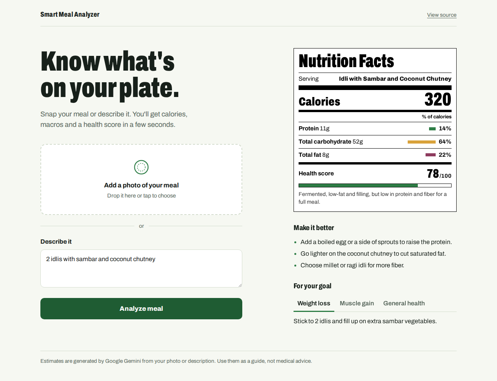
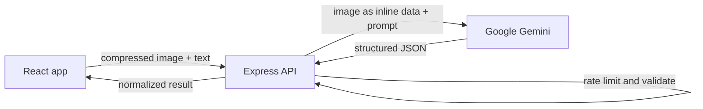

# Smart Meal Analyzer

Snap a photo of your meal or describe it, and get a nutrition label with calories, macros, and a health score.

**Live demo:** [meal.anandpabbineedi.site](https://meal.anandpabbineedi.site)



> The backend runs on a free server, so the first request can take up to a minute while it wakes up.

## Features

- **Photo, text, or both.** Upload a meal photo, describe it ("2 idlis with sambar"), or combine them so the description refines portion size.
- **Nutrition Facts label.** Calories, protein, carbs, and fat, with each macro's share of calories calculated from grams (4 kcal/g for protein and carbs, 9 kcal/g for fat).
- **Health score and tips.** A score out of 100 with the reasoning behind it, suggestions to improve the meal, and tips for weight loss, muscle gain, or general health.
- **Non-food detection.** Photos that aren't food get a clear message instead of a made-up label.

## How it works



1. The browser compresses the photo (max 1024px, about 0.5 MB) before upload, so requests stay fast on mobile data.
2. The Express API checks rate limits, validates the file (JPG, PNG, WEBP, or HEIC up to 5 MB) and the description (up to 500 characters).
3. The image goes to Gemini as inline data, held in memory and never written to disk, with a prompt that requires JSON output.
4. The server parses and normalizes the JSON, rejects non-food results, and returns a consistent shape to the frontend.

## Engineering decisions

| Decision | Why |
|---|---|
| Enforced JSON output (`responseMimeType: application/json`) | LLMs sometimes wrap JSON in prose or code fences. Asking for JSON at the API level, plus a fallback parser, makes the response reliably machine-readable. |
| In-memory uploads with `multer.memoryStorage()` | Nothing touches disk, so there are no leftover files when a request fails and no file cleanup to manage. |
| Per-IP rate limit plus a global daily cap | The demo is public and every request costs API quota. The per-IP limit stops one visitor from draining it; the daily cap is a hard ceiling on cost. |
| Origin allowlist (CORS) | Only this app's own domains can call the API from a browser. |
| Dynamic least-token model fallback | If a model hits traffic limits (HTTP 429 quota/rate limit) or is unavailable (HTTP 404/503), the server dynamically checks and attempts the least token-consuming models (`gemini-1.5-flash-8b`, `gemini-2.0-flash-lite`, `gemini-1.5-flash`, `gemini-2.0-flash`, `gemini-1.5-pro`) before presenting an error to the user. |
| Configurable model (`GEMINI_MODEL`) | Optional preference override. Defaults to the most token-efficient lightweight model (`gemini-1.5-flash-8b`). |

## Tech stack

- **Frontend:** React 19, Vite, browser-image-compression
- **Backend:** Node.js, Express 5, Multer
- **AI:** Google Gemini (multimodal) via `@google/generative-ai`
- **Hosting:** Netlify (frontend), Render (backend), custom domain with HTTPS

## API

`POST /analyze` (multipart form)

| Field | Type | Notes |
|---|---|---|
| `image` | file, optional | JPG, PNG, WEBP, or HEIC, up to 5 MB |
| `text` | string, optional | Meal description, up to 500 characters |

At least one is required. Returns `food_name`, `calories`, `protein`, `carbs`, `fat`, `score`, `scoreReason`, `suggestions`, and `goalTips`. Errors return `{ "error": "message" }` with status 400, 413, 422 (not food), 429 (rate limited), 502 (unreadable AI response), or 500.

`GET /` returns a health check with the active model.

## Run locally

**Backend**

```bash
cd backend
npm install
```

Create `backend/.env`:

```env
GEMINI_API_KEY=your_key_from_google_ai_studio
GEMINI_MODEL=gemini-1.5-flash-8b
```

```bash
node index.js
```

**Frontend**

```bash
cd frontend
npm install
```

Create `frontend/.env`:

```env
VITE_API_URL=http://localhost:5000
```

```bash
npm run dev
```

Open http://localhost:5173.

## Configuration

| Variable | Default | Purpose |
|---|---|---|
| `GEMINI_API_KEY` | (required) | Google AI Studio API key |
| `GEMINI_MODEL` | `gemini-1.5-flash-8b` | Preferred Gemini model (dynamically falls back to least token models if busy/unavailable) |
| `HOURLY_LIMIT_PER_IP` | `15` | Analyses per visitor per hour |
| `DAILY_LIMIT` | `300` | Total analyses per day across all visitors |
| `PORT` | `5000` | Server port |

## Limitations and next steps

- Nutrition values are AI estimates from a photo, not lab measurements.
- Rate limit counters live in memory and reset when the server restarts. A shared store like Redis would make them durable across instances.
- Possible additions: a meal history with daily totals, and user-confirmed portion sizes to improve accuracy.

## Author

Built by [Anand Pabbineedi](https://anandpabbineedi.site). [LinkedIn](https://www.linkedin.com/in/anand-pabbineedi-6b3b93257/)
